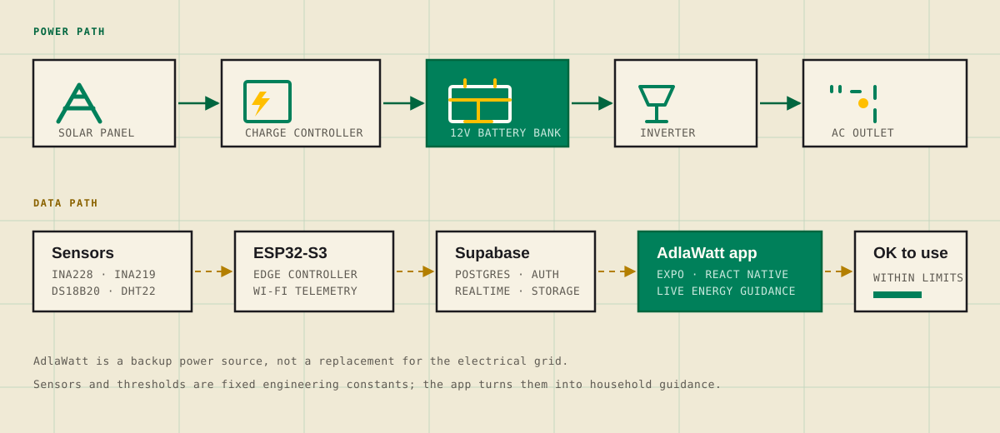

[](https://github.com/Team-AdlaWatt/AdlaWatt/actions/workflows/android.yml)
[](https://www.typescriptlang.org/)
[](https://expo.dev/)
[](https://supabase.com/)
[](https://www.espressif.com/)

# AdlaWatt: An IoT-Based Off-Grid Solar Backup Power System with Real-Time Energy Monitoring and Appliance Recommendation

**AdlaWatt** is a transportable, IoT-based off-grid solar energy harvesting system for households facing electricity interruptions. A solar panel charges a 12 V battery bank inside a lockable enclosure, and a built-in AC outlet supplies compatible appliances up to 600 W. An ESP32-S3 reads solar, battery, load, and temperature data; an Expo/React Native app provides live monitoring, appliance recommendations, notifications, activity logs, and historical data.

[Visit the AdlaWatt project site](https://team-adlawatt.github.io/AdlaWatt/) · [View the source code](https://github.com/Team-AdlaWatt/AdlaWatt) · [Read the user manual](docs/USER-MANUAL.md)

> **Project Status:** In Development. The mobile app is integrated with Supabase. The ESP32 hardware feed is still being wired up end to end. A web-based admin dashboard for researchers is planned.
>
> AdlaWatt is a backup power source, not a replacement for the electrical grid.

---

## Table of Contents

- [Get the Android App](#get-the-android-app)
- [What Is AdlaWatt?](#what-is-adlawatt)
- [System Overview](#system-overview)
- [How It Works](#how-it-works)
- [Features](#features)
- [Tech Stack](#tech-stack)
- [Project Structure](#project-structure)
- [Hardware](#hardware)
- [Backend Setup](#backend-setup)
- [Getting Started](#getting-started)
- [User Roles](#user-roles)
- [Admin Dashboard](#admin-dashboard)
- [Documentation](#documentation)
- [FAQ](#faq)
- [Changelog](#changelog)
- [Academic Context](#academic-context)
- [Contributors](#contributors)
- [License](#license)

---

## Get the Android App

Using AdlaWatt requires an AdlaWatt account. Download the Android app, then sign in or create an account.

<p align="center">
  <a href="https://drive.google.com/file/d/12auCzAkhCYNv_5iDn2_eoy-XgYcXLrAW/view?usp=sharing">
    
  </a>
</p>

<p align="center"><a href="https://drive.google.com/file/d/12auCzAkhCYNv_5iDn2_eoy-XgYcXLrAW/view?usp=sharing"><strong>Open the download page</strong></a></p>

1. Scan the QR code or open the download page.
2. Tap **Install**.
3. If Android blocks the install, allow your browser to install unknown apps:
   - **Android 8.0+ (API level 26+):** Settings → Apps → Special app access → Install unknown apps → select your browser → allow.
   - **Android 7.1.1 and lower (API level 25 and lower):** Settings → Security → enable **Unknown sources**.

---

## What Is AdlaWatt?

AdlaWatt is an IoT-based transportable off-grid solar energy harvesting system designed for homes that experience frequent electricity interruptions. A solar panel charges a 12 V battery bank inside a lockable enclosure, and a built-in AC outlet supplies compatible appliances up to 600 W.

The system also watches itself. An ESP32-S3 reads solar, battery, load, and temperature sensors, sends the data to Supabase, and the AdlaWatt mobile app shows it live. Its main feature is appliance recommendation: pick the appliances you plan to use and the app recommends what fits your current battery level.

The project combines four concerns in one system:

- **Off-grid solar harvesting** — collect and store energy without relying on the grid.
- **IoT energy monitoring** — measure battery, solar, load, and thermal conditions.
- **Household backup power** — run compatible appliances during outages.
- **Appliance recommendation** — decide what is safe to run before connecting a load.

## System Overview



The power path and the data path are separate. Solar energy charges the battery and feeds the AC outlet; the ESP32-S3 reads the system sensors and sends telemetry to Supabase, where the mobile app receives live updates and historical data.

## How It Works

1. **Harvest** — A solar panel charges the battery through a charge controller.
2. **Store** — Two ZENOVA 30Ah batteries are connected in parallel for a 12 V, 60 Ah bank.
3. **Convert** — An inverter supplies the built-in AC outlet for compatible appliances.
4. **Sense** — An ESP32-S3 reads solar, load, voltage, and temperature sensors.
5. **Guide** — The mobile app shows live status and labels appliances **OK to use** or **Not advisable** based on remaining energy, voltage, and power draw.

## Features

> **Scope note:** The manuscript defines the core scope. Features marked **(implementation addition)** are present in the app but extend beyond the manuscript's stated scope.

- **Real-Time Monitoring** — Battery status, voltage, energy, current load, depth of discharge, solar input, solar voltage/current, temperature readings, and device status, all updating live.
- **Appliance Recommendations** — Each appliance is labeled **OK to use** or **Not advisable** based on the remaining battery energy, voltage, and power draw.
- **Weather Information** — Current temperature, condition, and location. *(The 5-day solar forecast and Bukidnon location snapping are implementation additions.)*
- **Notifications** — Push notifications for critical battery, temperature, solar, load, and device-status alerts. *(Email delivery, vibration, and daily reminders are implementation additions.)*
- **Historical Data & Reports** — Charts and reports over selected date ranges and frequencies. *(The 17-chart layout and CSV/PDF export are implementation additions.)*
- **Device Status** — Live status for the ESP32, sensors, relay, fan, and display.
- **Activity Logs** — A history of system events, separate from notifications.
- **Admin Dashboard (implementation addition)** — Role-gated in-app admin view with fleet-wide aggregates across Overview, Users, and Reports tabs, plus pull-to-refresh. A web-based dashboard for researchers is planned.
- **Personalization (implementation addition)** — Dark mode, font size and family, language (English, Filipino, Cebuano), vibration, and email notifications.
- **Offline Support (implementation addition)** — The dashboard shows the last cached readings with an offline banner when there is no connection.

### Weather Location (implementation addition)

The weather card uses the device's live GPS fix. Within 10 km of one of the 24 configured Bukidnon points (22 Manolo Fortich barangays plus Lingi-on and Balubal), the app requests OpenWeather at that sample's exact coordinates for both current weather and forecast, then displays the resolved location label. Outside coverage, it keeps the raw GPS fix and shows a non-blocking notice. The forecast rows show condition, high temperature with Celsius units, daily max feels-like temperature, and solar outlook without rain-chance percentages.

---

## Tech Stack

> **Scope note:** The manuscript's software specification lists Arduino IDE, Visual Studio Code, C++, JavaScript, CSS, React.js (JSX), Supabase, Expo EAS, GitHub, and Canva. The table below reflects the current implementation, including additions beyond that list.

| Layer | Technology |
|---|---|
| Mobile App | Expo 57 (React Native 0.86) with Expo Router |
| Language | TypeScript |
| Backend | Supabase (PostgreSQL, Auth, Realtime, Edge Functions, Storage) |
| Weather | OpenWeatherMap API (current + 5-day forecast) |
| Charts | react-native-gifted-charts |
| Reports | jsPDF (web) and expo-print (native), plus CSV |
| Alerts | In-app + AgentMail email via a Supabase Edge Function |

---

## Project Structure

```text
AdlaWatt/
├── docs/                    # Project documentation
│   ├── buildplan.md
│   ├── UI-STANDARDS.md
│   ├── USER-MANUAL.md
│   ├── ISSUES.md
│   ├── TODO.md
│   ├── RECOMMENDATIONS.md
│   ├── tft-ui-ux.md
│   ├── future-css-ideas/    # Historical design ideas
│   └── implementation-plan/ # Implementation documentation
├── src/
│   ├── app/
│   │   ├── (opening)/splash.tsx
│   │   ├── auth/
│   │   │   ├── login.tsx
│   │   │   ├── register.tsx
│   │   │   ├── forgot-password.tsx
│   │   │   └── callback.tsx
│   │   ├── dashboard/
│   │   │   ├── index.tsx
│   │   │   ├── electronics.tsx
│   │   │   ├── analytics.tsx
│   │   │   ├── components.tsx
│   │   │   ├── notifications.tsx
│   │   │   ├── activity-logs.tsx
│   │   │   ├── menu.tsx
│   │   │   ├── about-us.tsx
│   │   │   └── user-manual.tsx
│   │   └── admin/            (role-gated admin dashboard)
│   ├── admin/               (admin UI: tabs, guards, formatters)
│   ├── components/           (charts, forms, layout, ui)
│   ├── constants/            (routes, catalog, colors, theme, sizing)
│   ├── context/              (auth, settings, theme)
│   ├── hooks/
│   ├── locales/              (en, fil, ceb)
│   ├── services/             (monitoring, notifications, analytics, ...)
│   └── lib/supabase.ts
├── supabase/
│   ├── functions/send-alert-email/
│   └── migrations/
├── assets/                   # Images, logos, electronics, components
├── site/                     # SEO landing page (GitHub Pages)
├── skills/                   # Agent skills (DESIGNER.md, DEVELOPER.md)
├── scripts/                  # Utility scripts
├── android/                  # Native Android project
├── app.json                  # Expo config
├── eas.json                  # EAS build/config
├── package.json
├── AGENTS.md                 # Agent instructions (kept at root)
└── README.md                 # This file (kept at root)
```

---

## Hardware

**Power**

| Component | Purpose |
|---|---|
| 100 W Jinko Monocrystalline Solar Panel | Collects solar energy |
| 30 A PWM Charge Controller | Regulates battery charging |
| 12 V Battery Bank (ZENOVA 30Ah ×2, parallel) | Stores energy — 12 V, 60 Ah |
| 1500 W Inverter | Converts DC to AC |
| AC Outlet | Powers compatible appliances up to 600 W |

**IoT**

| Component | Purpose |
|---|---|
| ESP32-S3 | Main controller and Wi-Fi communication |
| INA228 (Solar / Load) | Monitors solar and load voltage/current |
| DS18B20 (Battery / Solar) | Monitors temperatures |
| DHT22 | Monitors interior temperature and humidity |
| INA219 | Monitors battery voltage and current |
| Relay Module | Controls load and cooling fans |
| SPI TFT Display | Shows local real-time info |
| 2× 5V DC Fan | Cooling |

The manuscript limits compatible appliances to **600 W total** and excludes high-power appliances such as air-conditioners, washing machines, and electric stoves.

---

## Backend Setup

> **Scope note:** The tables, Edge Function, and storage buckets below describe the current implementation beyond the manuscript's stated scope.

Data lives in Supabase. Core tables used by the app:

| Table | Purpose |
|---|---|
| `users` | Profiles, role, email-notification preference |
| `monitoring` | Current live sensor readings |
| `monitoring_history` | Historical readings for analytics |
| `electronics` | Household electronics and their power ratings |
| `notifications` | In-app notification records |
| `activity_logs` | System activity history |
| `components` | IoT component list and status |

**Edge Function:** `send-alert-email` — a server-side AgentMail proxy (the API key never ships in the app).

**Storage buckets:** `email-assets` (email logo) and `appliance-images` (custom electronics photos).

---

## Getting Started

### Prerequisites

- Node.js and npm
- Expo CLI / EAS CLI
- Android Studio (for Android)
- A Supabase project and an OpenWeatherMap API key

### Steps

1. Clone the repository:

   ```bash
   git clone https://github.com/Team-AdlaWatt/AdlaWatt.git
   cd AdlaWatt
   ```

2. Create a `.env.local` file in the project root:

   ```text
   EXPO_PUBLIC_SUPABASE_URL=<your-supabase-url>
   EXPO_PUBLIC_SUPABASE_KEY=<your-supabase-anon-key>
   EXPO_PUBLIC_OWM_KEY=<your-openweathermap-key>
   EXPO_PUBLIC_AGENTMAIL_LOGO_URL=<public-url-of-the-email-logo>
   ```

3. Install dependencies:

   ```bash
   npm install
   ```

4. Start the development server:

   ```bash
   npm start
   ```

5. Run on Android:

   ```bash
   npm run android
   ```

For email alerts, set the server-only secrets and deploy the function:

```bash
supabase secrets set AGENTMAIL_API_KEY=<agentmail-key>
supabase functions deploy send-alert-email
```

---

## User Roles

| Role | Access |
|---|---|
| Household User | Mobile app: dashboard, appliance recommendations, historical data, device status, notifications, activity logs, and settings |
| Admin | In-app dashboard (role-gated): fleet-wide aggregates across Overview, Users, and Reports tabs; pseudonymous summaries only. A web-based dashboard for researchers is planned. |

Users sign up with a username, email, and password, or sign in with Google. Passwords can be reset by email. *(Authentication is an implementation addition beyond the manuscript.)*

---

## Admin Dashboard

The in-app admin dashboard lives in `src/admin/` behind the role gate in `src/app/admin/`. Signing in with an `admin` account lands on it automatically; household users are bounced to `/dashboard`, signed-out users to `/login`.

```text
src/admin/
├── components/
│   ├── AdminDashboardScreen.tsx   # One fleet fetch, tab state, pull-to-refresh
│   ├── AdminScreenContainer.tsx   # Layout shell + bottom tab bar
│   ├── AdminNavBarTop.tsx         # Top bar + account menu (log out, exit)
│   ├── AdminNavBarBottom.tsx      # Overview / Users / Reports tabs
│   ├── AdminOverviewTab.tsx       # KPI cards + fleet status
│   ├── AdminUsersTab.tsx          # Fleet aggregate detail rows
│   ├── AdminReportsTab.tsx        # Fleet aggregate stat cards
│   └── AdminTabShared.tsx         # Shared loading/error/header pieces
├── hooks/
│   └── useAdminGuard.ts           # Client role gate + redirects
├── __tests__/
│   └── format.test.ts             # Shared formatter tests
├── constants.ts                   # Tab definitions
└── format.ts                      # Shared value formatters
```

All data comes only from the `get_admin_fleet_health` SECURITY DEFINER RPC (see `src/services/adminService.ts`): fleet-wide, pseudonymous aggregates — no user IDs, emails, or raw monitoring rows. The admin area is pinned to light mode and English-only, so household theme and language settings never restyle it.

---

## Documentation

- [User Manual](docs/USER-MANUAL.md) — setup, screens, and everyday use.
- [Build Plan](docs/buildplan.md) — product scope and system plan.
- [Known Issues](docs/ISSUES.md) — current bugs, fixes, and verification notes.
- [UI Standards](docs/UI-STANDARDS.md) — visual and interaction rules.
- [Recommendations](docs/RECOMMENDATIONS.md) — engineering and product follow-ups.
- [Implementation Notes](docs/implementation-plan/) — subsystem design documents.

---

## FAQ

### What is AdlaWatt?

AdlaWatt is an IoT-based transportable off-grid solar backup power system with an ESP32 monitor and a mobile app for real-time energy monitoring, appliance recommendations, notifications, and outage planning.

### How does AdlaWatt monitor solar and battery data?

An ESP32-S3 reads voltage, current, and temperature sensors, sends the readings to Supabase, and the AdlaWatt mobile app displays live battery, solar, load, and system-health data.

### What appliances can AdlaWatt power?

AdlaWatt works with compatible household appliances up to **600 W total** through its built-in AC outlet. High-power appliances such as air-conditioners, washing machines, and electric stoves are excluded. The app compares remaining energy, battery voltage, and appliance power draw to label each item **OK to use** or **Not advisable**.

### Is AdlaWatt available for purchase?

No. AdlaWatt is an academic capstone prototype in development and is not a commercial product.

### Is the AdlaWatt source code open source?

The repository is publicly viewable, but no open-source license is specified. Reuse, redistribution, or modification requires permission from the authors.

### Where was AdlaWatt built?

AdlaWatt was developed by the AdlaWatt Research and Development Team at Northern Bukidnon State College in Bukidnon, Philippines. The prototype was evaluated in Sto. Niño, Manolo Fortich, Bukidnon.

---

## Changelog

### Latest Changes

> Changelog entries describe implementation changes, including additions beyond the manuscript scope.

- **Bukidnon weather snapping** — live GPS snaps to the nearest configured sample within 10 km for current weather and forecast, displays the resolved location, and warns outside coverage.
- **4-day forecast** — daily rows now show high temperature in Celsius plus feels-like temperature, with rain-chance percentages removed.
- **5-day solar forecast** — daily solar outlook with a "best day to charge" summary and hot/cold flags.
- **Appliance catalog refresh** — updated to the current appliance list with corrected wattage ranges and new images.
- **Battery model** — the app uses 720 Wh nominal / 144 Wh reserve / 576 Wh usable for its calculations, matching the manuscript's 12 V, 60 Ah battery bank.
- **Self-hosted auth links** — confirmation and recovery emails now route back into the app, with clearer create-account copy.
- **Language support** — English, Filipino, and Cebuano.
- **Analytics** — 17 charts across five sections with CSV and PDF export.

---

## Academic Context

- **Sustainable Development Goal** — SDG 7 (Affordable and Clean Energy).
- **Evaluation** — Usability measured with the System Usability Scale (SUS).
- **Purpose** — To provide an affordable backup power solution that combines off-grid solar harvesting, real-time monitoring, and appliance recommendations in a single system.
- **Institution** — Northern Bukidnon State College, Bukidnon, Philippines.
- **Deployment** — Single prototype evaluated in selected households in Sto. Niño, Manolo Fortich, Bukidnon.
- **Manuscript date** — July 2025.

---

## Contributors

**AdlaWatt Research and Development Team**

- Rhics T. Geonzon — Documenter
- Francis Adrian Idul — Programmer
- Troy M. Rojo — Data Analyst

Northern Bukidnon State College, Bukidnon, Philippines. Developed as an academic capstone project.

---

## License

This project is an academic capstone project with **no open-source license specified**. Please do not assume the code is available for commercial use, redistribution, or modification without permission from the authors.

Copyright © 2025 AdlaWatt Research and Development Team.
