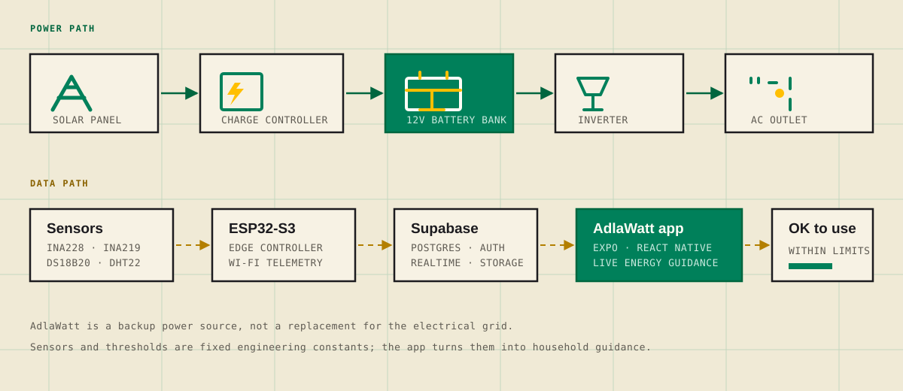

[](https://github.com/Team-AdlaWatt/AdlaWatt/actions/workflows/android.yml)
[](https://www.typescriptlang.org/)
[](https://expo.dev/)
[](https://supabase.com/)
[](https://www.espressif.com/)

# AdlaWatt: Off-Grid Solar Power Monitoring & Backup System

**AdlaWatt** is a transportable off-grid solar power system and IoT energy monitoring platform for households facing electricity interruptions. An ESP32-S3 reads solar, battery, load, and temperature data; an Expo/React Native app turns that data into live monitoring, electronics guidance, and backup-power planning.

[Visit the AdlaWatt project site](https://team-adlawatt.github.io/AdlaWatt/) · [View the source code](https://github.com/Team-AdlaWatt/AdlaWatt) · [Read the user manual](USER-MANUAL.md)

> **Project Status:** In Development. The mobile app is fully integrated with Supabase (auth, database, real-time). The ESP32 hardware feed is still being wired up end to end.
>
> AdlaWatt is a backup power source, not a replacement for the electrical grid.

---

## Table of Contents

- [What Is AdlaWatt?](#what-is-adlawatt)
- [System Overview](#system-overview)
- [How It Works](#how-it-works)
- [Features](#features)
- [Tech Stack](#tech-stack)
- [Project Structure](#project-structure)
- [Hardware](#hardware)
- [Backend Setup](#backend-setup)
- [Getting Started](#getting-started)
- [User Roles](#user-roles)
- [Documentation](#documentation)
- [FAQ](#faq)
- [Changelog](#changelog)
- [Academic Context](#academic-context)
- [Contributors](#contributors)
- [License](#license)

---

## What Is AdlaWatt?

AdlaWatt is an off-grid solar power and backup battery system designed for homes that experience frequent electricity interruptions. A solar panel charges a 12V battery inside a transportable lockable enclosure, and a built-in AC outlet lets compatible electronics use the stored energy.

The system also watches itself. An ESP32-S3 reads solar, load, voltage, and temperature sensors, sends the data to Supabase, and the AdlaWatt mobile app shows it live. Its main feature is electronics guidance: pick the electronics you plan to use and the app recommends what fits your current battery level.

The project combines four concerns in one system:

- **Off-grid solar harvesting** — collect and store energy without relying on the grid.
- **IoT energy monitoring** — measure battery, solar, load, and thermal conditions.
- **Household backup power** — run compatible electronics during outages.
- **Electronics guidance** — decide what is safe to run before connecting a load.

## System Overview



The power path and the data path are separate. Solar energy charges the battery and feeds the AC outlet; the ESP32-S3 reads the system sensors and sends telemetry to Supabase, where the mobile app receives live updates and historical data.

## How It Works

1. **Harvest** — A solar panel charges the battery through a charge controller.
2. **Store** — Two ZENOVA 30Ah batteries hold 756 Wh nominal, with 604.8 Wh usable.
3. **Convert** — An inverter supplies the built-in AC outlet for compatible electronics.
4. **Sense** — An ESP32-S3 reads solar, load, voltage, and temperature sensors.
5. **Guide** — The mobile app shows live status and labels electronics **OK to use** or **Not advisable** based on remaining energy, voltage, and power draw.

## Features

- **Real-Time Monitoring** — Battery percentage, voltage, watt-hours, time remaining, charge/discharge status, load, depth of discharge, solar input, and battery/solar/interior temperatures, all updating live.
- **Electronics Recommendations** — Each electronics item is labeled **OK to use** or **Not advisable** based on the remaining battery energy, voltage, and power draw.
- **Weather & 5-Day Solar Forecast** — Current temperature, condition, and location, plus a 5-day outlook that flags the best day to charge.
- **Notifications** — Automatic alerts for battery, temperature, solar, load, and device status. Delivered in-app, by email for alerts, with an alert vibration, plus daily local reminders.
- **Analytics & Reports** — 17 charts across Battery, Solar, Energy, Health, and Usage, with CSV and PDF export.
- **Component Health** — Live status for each IoT and power component (ESP32, sensors, relay, fan, display).
- **Activity Logs** — A paginated history of system events, separate from notifications.
- **Personalization** — Dark mode, font size and family, language (English, Filipino, Cebuano), vibration, and email notifications.
- **Offline Support** — The dashboard shows the last cached readings with an offline banner when there is no connection.

### Weather Location

The weather card uses the device's live GPS fix. Within 10 km of one of the 24 configured Bukidnon points (22 Manolo Fortich barangays plus Lingi-on and Balubal), the app requests OpenWeather at that sample's exact coordinates for both current weather and forecast, then displays the resolved location label. Outside coverage, it keeps the raw GPS fix and shows a non-blocking notice. The 4-day forecast shows condition, high temperature with Celsius units, daily max feels-like temperature, and solar outlook without rain-chance percentages.

---

## Tech Stack

| Layer | Technology |
|---|---|
| Mobile App | Expo 57 (React Native 0.86) with Expo Router |
| Language | TypeScript |
| Backend | Supabase (PostgreSQL, Auth, Realtime, Edge Functions, Storage) |
| Weather | OpenWeatherMap API (current + 5-day forecast) |
| Charts | react-native-gifted-charts |
| Reports | jsPDF (web) and expo-print (native), plus CSV |
| Alerts | In-app + AgentMail email via a Supabase Edge Function |

---

## Project Structure

```text
AdlaWatt/
├── docs/                    # Project documentation
│   ├── buildplan.md
│   ├── UI-STANDARDS.md
│   ├── USER-MANUAL.md
│   ├── ISSUES.md
│   ├── TODO.md
│   ├── RECOMMENDATIONS.md
│   ├── tft-ui-ux.md
│   ├── AGENTS.md
│   ├── future-css-ideas/    # Historical design ideas
│   └── implementation-plan/ # Implementation documentation
├── src/
│   ├── app/
│   │   ├── (opening)/splash.tsx
│   │   ├── auth/
│   │   │   ├── login.tsx
│   │   │   ├── register.tsx
│   │   │   ├── forgot-password.tsx
│   │   │   └── callback.tsx
│   │   ├── dashboard/
│   │   │   ├── index.tsx
│   │   │   ├── electronics.tsx
│   │   │   ├── analytics.tsx
│   │   │   ├── components.tsx
│   │   │   ├── notifications.tsx
│   │   │   ├── activity-logs.tsx
│   │   │   ├── menu.tsx
│   │   │   ├── about-us.tsx
│   │   │   └── user-manual.tsx
│   │   └── admin/            (role-gated shell)
│   ├── components/           (charts, forms, layout, ui)
│   ├── constants/            (routes, catalog, colors, theme, sizing)
│   ├── context/              (auth, settings, theme)
│   ├── hooks/
│   ├── locales/              (en, fil, ceb)
│   ├── services/             (monitoring, notifications, analytics, ...)
│   └── lib/supabase.ts
├── supabase/
│   ├── functions/send-alert-email/
│   └── migrations/
├── assets/                   # Images, logos, electronics, components
├── skills/                   # Agent skills (DESIGNER.md, DEVELOPER.md)
├── scripts/                  # Utility scripts
├── android/                  # Native Android project
├── app.json                  # Expo config
├── eas.json                  # EAS build/config
├── package.json
├── AGENTS.md                 # Agent instructions (kept at root)
└── README.md                 # This file (kept at root)
```

---

## Hardware

**Power**

| Component | Purpose |
|---|---|
| Solar Panel | Collects solar energy |
| Charge Controller | Regulates battery charging |
| 12V Battery (ZENOVA 30Ah ×2) | Stores energy — 756 Wh nominal, 604.8 Wh usable |
| Inverter | Converts DC to AC |
| AC Outlet | Powers compatible electronics |

**IoT**

| Component | Purpose |
|---|---|
| ESP32-S3 | Main controller and Wi-Fi communication |
| INA228 (Input / Output) | Monitors solar and load voltage/current |
| DS18B20 (Battery / Solar) | Monitors temperatures |
| DHT22 | Monitors interior temperature and humidity |
| INA219 | Measures system voltage |
| Relay Module | Controls load and cooling fan |
| SPI TFT Display | Shows local real-time info |
| 5V DC Fan | Cooling |

Safety thresholds are fixed engineering constants: **800 W** high load, **11.6 V** minimum, **14.6 V** maximum.

---

## Backend Setup

Data lives in Supabase. Core tables used by the app:

| Table | Purpose |
|---|---|
| `users` | Profiles, role, email-notification preference |
| `monitoring` | Current live sensor readings |
| `monitoring_history` | Historical readings for analytics |
| `electronics` | Household electronics and their power ratings |
| `notifications` | In-app notification records |
| `activity_logs` | System activity history |
| `components` | IoT component list and status |

**Edge Function:** `send-alert-email` — a server-side AgentMail proxy (the API key never ships in the app).

**Storage buckets:** `email-assets` (email logo) and `appliance-images` (custom electronics photos).

---

## Getting Started

### Prerequisites

- Node.js and npm
- Expo CLI / EAS CLI
- Android Studio (for Android)
- A Supabase project and an OpenWeatherMap API key

### Steps

1. Clone the repository:

   ```bash
   git clone https://github.com/Team-AdlaWatt/AdlaWatt.git
   cd AdlaWatt
   ```

2. Create a `.env.local` file in the project root:

   ```text
   EXPO_PUBLIC_SUPABASE_URL=<your-supabase-url>
   EXPO_PUBLIC_SUPABASE_KEY=<your-supabase-anon-key>
   EXPO_PUBLIC_OWM_KEY=<your-openweathermap-key>
   EXPO_PUBLIC_AGENTMAIL_LOGO_URL=<public-url-of-the-email-logo>
   ```

3. Install dependencies:

   ```bash
   npm install
   ```

4. Start the development server:

   ```bash
   npm start
   ```

5. Run on Android:

   ```bash
   npm run android
   ```

For email alerts, set the server-only secrets and deploy the function:

```bash
supabase secrets set AGENTMAIL_API_KEY=<agentmail-key>
supabase functions deploy send-alert-email
```

---

## User Roles

| Role | Access |
|---|---|
| Household User | Full app: dashboard, electronics, analytics, components, notifications, activity logs, and settings |
| Admin | A limited shell (login, log out, exit) — assigned in the database, not through the app |

Users sign up with a username, email, and password, or sign in with Google. Passwords can be reset by email.

---

## Documentation

- [User Manual](USER-MANUAL.md) — setup, screens, and everyday use.
- [Build Plan](buildplan.md) — product scope and system plan.
- [Known Issues](ISSUES.md) — current bugs, fixes, and verification notes.
- [UI Standards](UI-STANDARDS.md) — visual and interaction rules.
- [Recommendations](RECOMMENDATIONS.md) — engineering and product follow-ups.
- [Implementation Notes](implementation%20plan/) — subsystem design documents.

---

## FAQ

### What is AdlaWatt?

AdlaWatt is a transportable off-grid solar power and backup system with an ESP32 IoT monitor and a mobile app for real-time energy monitoring, electronics guidance, notifications, and outage planning.

### How does AdlaWatt monitor solar and battery data?

An ESP32-S3 reads voltage, current, and temperature sensors, sends the readings to Supabase, and the AdlaWatt mobile app displays live battery, solar, load, and system-health data.

### What electronics can AdlaWatt power?

AdlaWatt works with compatible household electronics through its built-in AC outlet. The app compares remaining energy, battery voltage, and device power draw to label each item **OK to use** or **Not advisable**.

### Is AdlaWatt available for purchase?

No. AdlaWatt is an academic capstone prototype in development and is not a commercial product.

### Is the AdlaWatt source code open source?

The repository is publicly viewable, but no open-source license is specified. Reuse, redistribution, or modification requires permission from the authors.

### Where was AdlaWatt built?

AdlaWatt was developed by the AdlaWatt Research and Development Team at Northern Bukidnon State College in Bukidnon, Philippines.

---

## Changelog

### Latest Changes

- **Bukidnon weather snapping** — live GPS snaps to the nearest configured sample within 10 km for current weather and forecast, displays the resolved location, and warns outside coverage.
- **4-day forecast** — daily rows now show high temperature in Celsius plus feels-like temperature, with rain-chance percentages removed.
- **5-day solar forecast** — daily solar outlook with a "best day to charge" summary and hot/cold flags.
- **Electronics catalog refresh** — updated to the current electronics list with corrected wattage ranges and new images.
- **Battery figures** — standardized to 756 Wh nominal / 151.2 Wh reserve / 604.8 Wh usable.
- **Self-hosted auth links** — confirmation and recovery emails now route back into the app, with clearer create-account copy.
- **Language support** — English, Filipino, and Cebuano.
- **Analytics** — 17 charts across five sections with CSV and PDF export.

---

## Academic Context

- **Sustainable Development Goals** — SDG 7 (Affordable and Clean Energy), SDG 11 (Sustainable Cities and Communities), and SDG 13 (Climate Action).
- **Evaluation** — Usability measured with the System Usability Scale (SUS).
- **Purpose** — To provide an affordable backup power solution that combines off-grid solar harvesting, real-time monitoring, and electronics guidance in a single system.
- **Institution** — Northern Bukidnon State College, Bukidnon, Philippines.

---

## Contributors

**AdlaWatt Research and Development Team**

- Francis Adrian Idul — Programmer
- Rhics T. Geonzon — Documenter
- Troy M. Rojo — Data Analyst

Northern Bukidnon State College, Bukidnon, Philippines. Developed as an academic capstone project.

---

## License

This project is an academic capstone project with **no open-source license specified**. Please do not assume the code is available for commercial use, redistribution, or modification without permission from the authors.

Copyright © 2026 AdlaWatt Research and Development Team.
